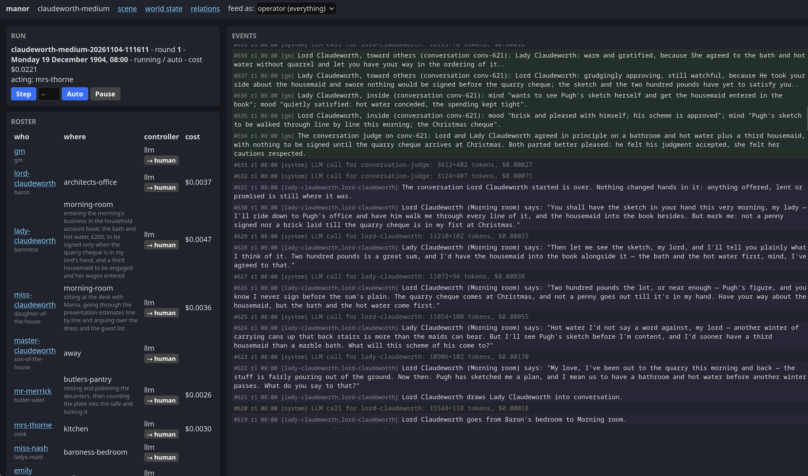
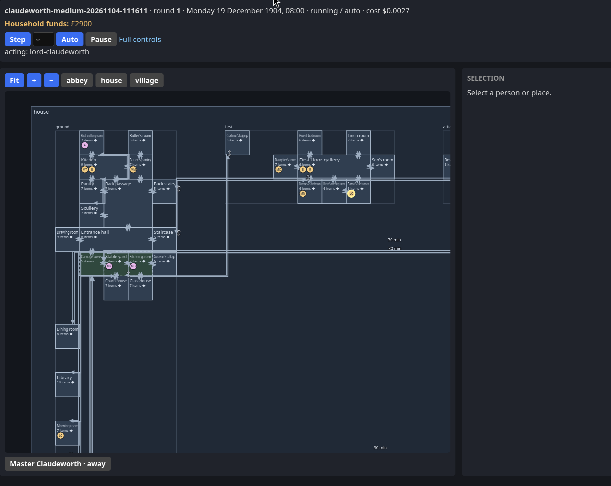

# CLAUDE MANOR - A VERITABLE DOWNTON ABBEY OF LLM AGENTS

## Running

```sh
clojure -M:run claudeworth-medium
```

Then open up the web UI and let it rip.


## Requirements

- Clojure CLI (1.12+) and a JDK
- Node.js and pi for the pi MCP server that aren't integrated anywhere at the moment
- Babashka for the architect MCP server (Used by `claudeworth` scenarios to construct manor additions and follies).
  Babashka also runs the people server, which `roll-cast!` uses (and its tests).
- An OpenRouter key in `MANOR_OPENROUTER_API_KEY` for real runs. This was coded against OpenRouter and has been tested against nothing else.


## Web UI

Experimental and partially functional

## Cache and cost report

`manor.tools.cache-report` reads a run's `llm.edn` (it never calls a model) and shows how well its
prompts hit the provider's prompt cache. Prices, peak hours and the cache block size are in
`resources/pricing.edn`.

```sh
clojure -M:cache report runs/<id> [--top N]
clojure -M:cache simulate runs/<id> [--order system-first|tools-first] [--tier off-peak|peak] [--top N]
clojure -M:cache compare test-runs/<a> test-runs/<b> [--order ...] [--tier ...]
```

## Screenshots

The control panel shows the run, the roster and the event feed:



The scene page draws the house and who is where:


