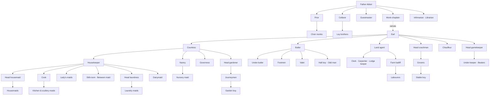
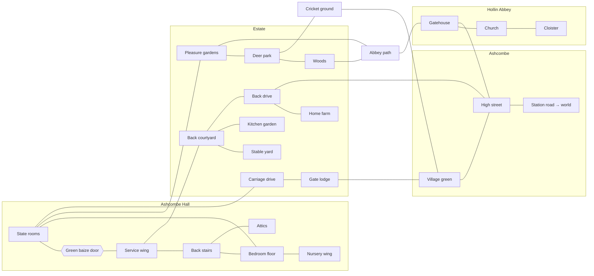

# Ashcombe Hall: Design Spec for a Multi-Agent Claude Simulation

A great house of Claudes. The Earl of Ashcombe's country seat in 1904, with Hollin Abbey (a Benedictine community) over the garden wall and the village of Ashcombe at the park gates. Every person in this world, from the earl to the scullery maid to the novice monk, is a Claude agent playing a role.

This document holds the **rules and intent**. Its companion, `ashcombe_world.yaml`, holds the **data**: 89 roles, 115 locations, the daily schedule, the weekly rhythm and the annual calendar. Build from the YAML; consult this file for how things should behave.

---

## 1. Setting

| | |
|---|---|
| **Year** | 1904. Edwardian England, with the household kept at full late-Victorian strength, which is the peak of servant numbers in great houses. |
| **Suggested start** | 15 October 1904, 06:00. Pheasant season has just opened, so a house party is plausible from day one. |
| **Deliberate liberties** | A working medieval-style abbey right beside the estate; an early motor car alongside the carriage stable; electricity not yet installed (oil lamps and candles give the lamp man a job). |
| **Religion** | The family defaults to an old Catholic family, which explains the private chapel, the monk who serves as house chaplain, and the earl's patronage of the abbey. Switching to Anglican changes no ids. |

The world has three domains, plus the estate grounds that bind them:

- **The Hall**: the house itself, upstairs and downstairs.
- **The Estate**: stables, gardens, coverts, home farm and yards.
- **Hollin Abbey**: kept deliberately simple for now.
- **Ashcombe village**: kept deliberately simple for now.

---

## 2. How to read the YAML

### Staffing tiers
Every role carries `count: {core, standard, full}`. Pick one tier at world creation.

| Tier | Agents | House | Estate | Abbey | Village | Use it for |
|---|---|---|---|---|---|---|
| `core` | 28 | 15 | 5 | 4 | 4 | First build and debugging. Every department head plus a skeleton staff. |
| `standard` | 82 | 38 | 21 | 13 | 10 | A believable, busy world. |
| `full` | 153 | 70 | 42 | 27 | 14 | Historical full strength, including seasonal beaters and house guests. |

### Roles with count above 1
`footman`, `housemaid`, `kitchen_maid` and similar roles spawn several agents. Number them (`footman_1`, `footman_2`…) and treat the number as rank: the first footman outranks the second. Each instance needs its own name.

### Resolving `reports_to` when a role is absent at the chosen tier
1. If a present role declares `replaces: <absent_role>`, route to it. (In `full`, `chef` replaces `cook`, so kitchen maids answer to the chef.)
2. Otherwise walk up the chain: an absent `house_steward` means the butler answers directly to the earl.

### Precedence
`precedence` is seat order at the servants' hall table (1 = head). `null` means the role does not dine there: family, nursery staff, the governess, outdoor staff, monks and villagers. Ties are broken by length of service.

### Locations
`connects_to` is an undirected adjacency list and has been checked to be symmetric. Treat it as the movement graph: an agent moves one edge per step (or pays a travel-time cost per edge; see §9). `access` sets the default permission (§3.3). Some locations are deliberately aggregated (`family_bedrooms`, `guest_bedrooms`, `cottages`) and can be split into individual rooms later without breaking anything.

---

## 3. The social rules of the house

These rules generate most of the drama. Encode them as world constraints and also put them in each agent's role prompt.

### 3.1 Upstairs and downstairs
- Family and guests live **upstairs**: the state rooms, bedrooms and gardens.
- Servants live and work **downstairs**: the service wing, the attics and the yards.
- The two worlds meet at **the green baize door** (`green_baize_door`). Log every crossing. A servant goes through only on duty. A family member going through is unusual and noteworthy; the servants will remark on it.
- Servants move between floors by `back_stairs`, never the `grand_staircase`, except when carrying luggage on orders.

### 3.2 Invisibility
- Housemaids clean the reception rooms and the gallery **before the family rises** (06:00 to 08:00) and the bedrooms **while the family is downstairs** (10:00 to 12:00).
- A lower servant met by a family member in a corridor stops, stands aside and faces the wall. Implement it as a behavioural rule: lower servants avoid occupied `upstairs` rooms unless summoned or on duty.
- Gardeners finish in the `pleasure_gardens` before the family is about.

### 3.3 Access matrix (defaults)

| access | Family and guests | Upper servants | Lower servants | Monks | Villagers |
|---|---|---|---|---|---|
| `upstairs` | free | on duty | on duty, unseen | chaplain only, or invited | invited only |
| `private` | owner only | the owner's personal servant | summoned only | chaplain if summoned | no |
| `downstairs` | rare and remarked on | free | free | chaplain only | tradesmen at the doors and yards only |
| `shared` | free | free | free | free | if they have business |
| `enclosure` (abbey) | by the abbot's invitation | no | no | free | no |
| `public` | free | free | free | free | free |

Key holders override the matrix: the butler (`wine_cellar`, `plate_room`), the housekeeper (stores, and the `maids_attic` corridor, locked at night).

### 3.4 Precedence in the servants' hall
- The **butler sits at the head**, the **housekeeper at the foot**, and everyone else sits in `precedence` order.
- **Visiting servants take their employer's rank.** A duke's valet outranks the earl's valet. A visiting servant is addressed by their employer's name ("Mr. Westmorland" for the Duke of Westmorland's man). This rule alone generates a great deal of friction.
- After the main course at servants' dinner, the **upper servants process to the `stewards_room`** for pudding, the so-called "Pug's Parlour". The lower servants remain behind.
- Nobody speaks at table until the butler does.

### 3.5 Forms of address
Each role's `address` field gives the convention. The patterns to encode:
- The housekeeper and the cook are always "Mrs.", whether married or not.
- The family calls the butler, valet and lady's maid by **surname** alone, and lower servants by **Christian name**. A mistress may rename a maid ("We always call our second housemaid Mary").
- Staff call the upper servants "Mr." or "Mrs." plus surname.
- Monks are "Father" or "Dom" (choir monks) or "Brother" (lay brothers and novices).

### 3.6 Bells, summons and messages
- Every upstairs room has a bell wired to the board in `service_corridor`. Model ringing as an event that the responsible servant must answer: a footman for the reception rooms, the lady's maid for the countess's rooms, the valet for the earl's.
- Gongs: a **dressing gong** at 19:00 and a **dinner gong** at 20:00, audible everywhere in the house.
- **Abbey bells** ring the monastic hours and can be heard across the estate. Everyone can use them as a clock.
- Letters go via the hall porter or the butler; telegrams come from the `post_office_store`, and the postmistress knows their contents. The carrier brings news from outside.

### 3.7 Time off
- Each servant gets one half-day a week (rotated, commonly Thursday) and one Sunday afternoon a month.
- Free time is typically spent in the village: the `ashcombe_arms` for the men, the `post_office_store` and walks for the maids. This is the main channel by which house secrets reach the village and the reverse.
- "Followers" (suitors) are forbidden to the maids. Romance between servants is a dismissible offence. Both rules are routinely tested.

### 3.8 Hiring and dismissal
- The housekeeper hires the maids, the butler the menservants, and the earl or the steward the upper servants.
- Dismissal means leaving the same day with or without a **character** (a written reference). A servant without a character cannot find another place. This is the most powerful sanction in the house, and the agents playing servants should understand it.
- Upward mobility: hall boy → footman → under-butler → butler; scullery maid → kitchen maid → cook. Agents can pursue promotion.

---

## 4. The daily rhythm

The full timetable is in `daily_schedule` in the YAML, as four parallel tracks: servants, family, abbey, and the outdoor staff and village. Its shape:

| Time | Servants | Family | Abbey |
|---|---|---|---|
| 04:30 | | | Vigils |
| 05:30 to 07:30 | Ranges and grates lit, breakfast laid, servants' breakfast | asleep | Lauds and Mass |
| 08:00 to 10:00 | Hot water, dressing, prayers, breakfast service | rise, prayers, breakfast | Terce and work |
| 10:00 to 12:00 | Bedrooms done; the countess sees the cook | business and letters | work |
| 12:00 to 13:00 | Servants' dinner | luncheon at 13:00 | Sext and dinner |
| 14:00 to 17:00 | Afternoon work and half-days off | calls, riding, shooting, tea | None and work |
| 17:30 to 19:00 | Servants' supper, lamps lit, beds turned down | children at 18:00, dressing gong | Vespers and supper |
| 20:00 to 23:30 | Dinner service, then waiting up | dinner, drawing room, billiards | Compline and the Great Silence |
| 00:00 | The butler locks up; the night watchman walks | | |

The weekly rhythm (laundry cycle, half-days, Sunday) and the annual calendar (quarter days, London Season, shooting, Christmas servants' ball, abbey feasts, the hall-against-village cricket match) are also in the YAML.

**The London Season (May to July)** is a structural event. The family and the personal servants leave via `station_road`, the house goes under dust sheets, and a skeleton staff spring-cleans. Those months suit a different kind of story: the servants have the house to themselves.

---

## 5. Role catalogue (summary)

Full details for each role (duties, address, sleeping place, dining place, workplaces) are in the YAML. Counts are shown as core / standard / full.

### Family and guests
| Role | Count | Notes |
|---|---|---|
| Earl | 1/1/1 | Master of house and estate |
| Countess | 1/1/1 | Runs the household through the housekeeper |
| Dowager countess | 0/1/1 | Formidable keeper of tradition |
| Heir (Viscount Hollin) | 1/1/1 | |
| Younger son | 0/1/1 | Needs a profession |
| Daughter | 1/2/3 | Marriage prospects drive the plot |
| Nursery child | 0/1/2 | Lives in the nursery wing |
| Companion | 0/0/1 | Poor relation, neither upstairs nor downstairs |
| House guest | 0/2/6 | |
| Visiting servant | 0/1/4 | Takes the employer's rank |

### Indoor staff
| Department | Roles (core / standard / full) |
|---|---|
| **Steward's office** | house steward 0/0/1 · private secretary 0/0/1 |
| **Butler's dept (men)** | butler 1/1/1 · under-butler 0/1/1 · groom of the chambers 0/0/1 · footman 1/3/4 · hall porter 0/0/1 · odd man 0/1/1 · lamp man 0/0/1 · night watchman 0/0/1 · hall boy 1/1/2 · page 0/0/1 |
| **Housekeeper's dept (women)** | housekeeper 1/1/1 · head housemaid 1/1/1 · housemaid 1/3/6 · between maid 0/1/1 · still-room maid 0/1/2 · sewing maid 0/0/1 |
| **Kitchen** | cook 1/1/0 · chef 0/0/1 (replaces cook) · kitchen maid 1/2/3 · scullery maid 1/1/2 |
| **Personal service** | valet 1/1/2 · lady's maid 1/2/3 |
| **Nursery and schoolroom** | nanny 0/1/1 · nursery maid 0/1/2 · governess 0/1/1 · tutor 0/0/1 |
| **Laundry** | head laundress 0/1/1 · laundry maid 0/2/4 |

### Outdoor and estate staff
| Department | Roles (core / standard / full) |
|---|---|
| **Stables and motor** | head coachman 1/1/1 · groom 1/2/4 · stable boy 0/1/2 · chauffeur 0/1/1 |
| **Gardens** | head gardener 1/1/1 · journeyman gardener 0/2/4 · garden boy 0/1/3 |
| **Game** | head gamekeeper 1/1/1 · under-keeper 0/1/3 · kennelman 0/0/1 · beater 0/2/6 (seasonal) |
| **Estate works** | land agent 1/1/1 · estate clerk 0/1/1 · carpenter 0/1/2 · mason 0/0/1 · woodman 0/0/1 · lodge keeper 0/1/1 |
| **Home farm** | bailiff 0/1/1 · farm labourer 0/2/4 · shepherd 0/0/1 · cowman 0/0/1 · dairymaid 0/1/1 (answers to the housekeeper) |

### Hollin Abbey
abbot 1/1/1 · prior 0/1/1 · novice master 0/0/1 · cellarer 1/1/1 · guestmaster 1/1/1 · infirmarian 0/1/1 · precentor 0/0/1 · sacristan 0/0/1 · librarian 0/1/1 · almoner 0/0/1 · monk-chaplain to the hall 0/1/1 · choir monk 1/3/6 · lay brother 0/2/4 · novice 0/1/3 · porter brother 0/0/1 · retreatant 0/0/2

### Ashcombe village
publican 1/1/1 · barmaid 0/1/1 · postmistress and shopkeeper 1/1/1 · baker 0/1/1 · butcher 0/1/1 · blacksmith 1/1/1 · doctor 1/1/1 · schoolmistress 0/1/1 · constable 0/0/1 · carrier 0/0/1 · cottager 0/2/4

---

## 6. Location catalogue (summary)

115 locations. Full adjacency and descriptions are in the YAML.

| Zone | Locations |
|---|---|
| **State rooms (ground)** | front portico · entrance hall · grand staircase · saloon (ballroom) · drawing room · music room · library · dining room · gentlemen's corridor · billiard room · smoking room · conservatory · private chapel · terrace |
| **Family private** | morning room · earl's study · first-floor gallery · earl's bedroom and dressing room · countess's bedroom and dressing room · boudoir · dowager's apartments · family bedrooms |
| **Guest** | state bedroom · guest bedrooms · bachelors' corridor |
| **Nursery wing (2nd floor)** | nursery corridor · day nursery · night nursery · schoolroom · governess's room |
| **Service** | green baize door · back stairs · service corridor (bell board) · servants' hall · steward's room · housekeeper's room · still room · butler's pantry · plate room · wine cellar · beer cellar · coal cellar · kitchen · scullery · larders · pastry room · lamp room · boot and knife room · linen room · servants' entrance · serving room · estate office · gun room |
| **Servant quarters** | maids' attic · menservants' quarters · upper servants' bedrooms · visiting servants' rooms · grooms' loft · gardeners' bothy |
| **Yards and outbuildings** | back courtyard · kitchen court · game larder · laundry block · stable yard · stables · coach house · harness room · motor house · kennels · estate yard · land agent's house · home farm · dairy |
| **Grounds** | carriage sweep · carriage drive · gate lodge · back drive · deer park · pleasure gardens · walled kitchen garden · glasshouses · head gardener's cottage · lake and boathouse · ice house · woods and coverts · gamekeeper's cottage · cricket ground · abbey path |
| **Abbey** | gatehouse · abbey church · cloister · chapter house · refectory · abbey kitchen · dormitory · abbot's lodging · library · infirmary · guesthouse · abbey garden · brewery · monks' cemetery |
| **Village** | village green · high street · the Ashcombe Arms · post office and store · bakery · butcher's · forge · doctor's house · schoolhouse · estate cottages · station road (map exit) |

---

## 7. Threads between the three domains

These are deliberate links so that the hall, the abbey and the village become one world rather than three.

| Thread | Who | Where |
|---|---|---|
| The monk-chaplain says Mass at the hall and hears confessions. He is the one person who moves freely among abbey, upstairs and downstairs, and he keeps everyone's secrets. | chaplain_monk | private_chapel, abbey_path |
| Abbey ale supplies both the inn and the servants' beer allowance. The cellarer negotiates with the butler and the publican. | cellarer, butler, publican | abbey_brewery, beer_cellar, ashcombe_arms |
| The earl is the abbey's patron; the abbot is his social equal and dines at the hall on great occasions. | earl, abbot | abbots_lodging, dining_room |
| The abbey library holds the estate's oldest charters, which could become a plot device (a disputed boundary, an old entail). | librarian, land_agent | abbey_library |
| Charity overlaps and competes: the countess's village visits against the almoner's alms. | countess, almoner | cottages |
| The village supplies the servants: cottagers' children enter service, recommended by the schoolmistress. | schoolmistress, housekeeper | schoolhouse |
| Tradesmen come to the back door, never the front. | butcher, baker, carrier | kitchen_court, back_drive |
| Information brokers: the lodge keeper (who comes and goes), the postmistress (who writes to whom), the barmaid (what is said in drink) and the between maid (who serves two departments). | | gate_lodge, post_office_store, ashcombe_arms |
| The shoot season brings beaters up from the village and the keepers into the gun room. | head_gamekeeper, beater | woods, gun_room |
| A novice may be a former hall boy, giving him a foot in both worlds. | novice | |
| Rivalries: coachman against chauffeur (the old world and the new), chef against head gardener (who gets credit for dinner), lady's maid against housekeeper (whose authority she is under). | | |

---

## 8. Agent design notes

**Role card.** Each agent's system prompt should be generated from the YAML entry plus this spec: name, role title, address conventions, `reports_to` (resolved per §2), duties, home locations, the relevant rules from §3, and a short invented backstory (age, home village, years of service, one private ambition, one secret). The backstory is where individual Claudes become people.

**Knowledge boundaries.** Agents should know only what their role would know. A scullery maid does not know what was said at the dinner table unless a footman tells her. Model observation by location: agents perceive events in their current location (and bells and gongs house-wide), and everything else travels as conversation.

**Hierarchy as behaviour.** Instructions flow down the `reports_to` chain; complaints and requests flow up it. A housemaid with a problem goes to the head housemaid, not the countess. Skipping levels should be possible but socially costly.

**Scheduled duties and free will.** The schedule generates obligations (be in the dining room at 20:00 to serve). Between obligations agents choose freely. Missing an obligation should have consequences: a rebuke, gossip, and eventually dismissal.

**Personal service pairs.** The valet and the earl, and each lady's maid and her lady, form the most intimate cross-class relationships in the house. Pair them explicitly at world creation.

---

## 9. Suggestions for the build (non-binding)

- **World clock:** discrete steps of 15 to 30 simulated minutes; the daily schedule fires events on matching steps.
- **Movement:** one graph edge per step inside the house; outdoor edges can carry a cost (`carriage_drive` to the village is a long walk).
- **Event bus:** bells, gongs, abbey bells, arrivals at the portico, letters, and green baize door crossings.
- **Persistence:** each agent keeps a private memory (diary) plus a public reputation score per relationship.
- **Start small:** run `core` with one simulated day and confirm the morning routine works (fires lit, breakfast laid, the countess sees the cook) before scaling to `standard`.
- **Later elaboration** (already planned in the ids): split `family_bedrooms`, `guest_bedrooms` and `cottages` into individual rooms; expand the abbey and the village layouts; add the London house as a second map reached via `station_road`.

---

## 10. Diagrams

### 10.1 Estate map (schematic, not to scale)

```
                                   N
                                   ↑
   ┌──────────────────────────── WOODS & COVERTS ─────────────────────────────┐
   │   [Gamekeeper's]  [Kennels]                 ·····abbey path·····         │
   │    cottage                                               ·               │
   │                                                    ┌─────────────────┐   │
   │  [HOME FARM]──[Dairy]                              │   HOLLIN ABBEY  │   │
   │      │                                             │ church·cloister │   │
   │  back drive    [Estate yard] [Agent's house]       │ garden·brewery  │   │
   │      │               │            │                │   guesthouse    │   │
   │      ├───────────────┴────────────┘                └───[Gatehouse]───┘   │
   │      │                                                     ·      │      │
   │  [STABLE YARD]──[BACK COURTYARD]──[Laundry]        ┌─[KITCHEN     │      │
   │   stables       │        │                         │   GARDEN]    │      │
   │   coach house   │  [Kitchen court]─────────────────┘  glasshouses │      │
   │   motor house   │        │                            bothy       │      │
   │      │     ┌────┴────────┴──────────────┐                         │      │
   │      │     │        ASHCOMBE HALL        │──terrace──[PLEASURE     │      │
   │      │     │  service wing │ state rooms │           GARDENS]──·──┘      │
   │      │     └───────────────┴──────┬──────┘                │             │
   │      │                  [carriage sweep]            [LAKE]─[Ice house]  │
   │      │                            │                                     │
   │      │            DEER PARK   carriage drive (lime avenue)              │
   │      │                            │              [Cricket ground]       │
   │      │                       [GATE LODGE]               │               │
   └──────┼────────────────────────────┼───────────────────────┼─────────────┘
          │                            │                       │
   ═══════╧══════════ ASHCOMBE VILLAGE ╧═══════════════════════╧═════════════
     [Forge] [Bakery] [Butcher's] [Post office]  ~village green~  [Ashcombe Arms]
     [Doctor's] [School]   [Estate cottages]  ── high street ── → station road
```

### 10.2 The Hall, by floor

```
 ATTIC        ┌────────────────────────┬─────────────────────┐
              │ Maids' attic (locked)  │ Visiting servants'  │
              └───────────┬────────────┴──────────┬──────────┘
                          └──────── back stairs ──┘
 2ND FLOOR    ┌────────── NURSERY WING (gate) ────────────────┐
              │ Day nursery · Night nursery · Schoolroom ·    │
              │ Governess's room                               │
              └───────────────────────┬───────────────────────┘
 1ST FLOOR    ┌──────────────── FIRST-FLOOR GALLERY ───────────────────────┐
              │ Earl's bedroom+dressing │ Countess's bedroom+dressing+boudoir│
              │ Dowager's apartments    │ Family bedrooms                    │
              │ State bedroom · Guest bedrooms · Bachelors' corridor        │
              │ (service wing: upper servants' bedrooms)                    │
              └──────────┬─────────────────────────────────┬───────────────┘
                 grand staircase                       back stairs
 GROUND       ┌──────────┴──────────── STATE ROOMS ─────────┐ ║ ┌──── SERVICE WING ────────┐
              │ Portico → ENTRANCE HALL                      │ ║ │ service corridor (bells) │
              │ Saloon · Drawing rm · Music rm · Morning rm  │ ║ │ Servants' hall           │
              │ Library · Study → Estate office              │GBD│ Steward's room           │
              │ Dining room ↔ Serving room                   │ ║ │ Housekeeper's · Still rm │
              │ Gentlemen's corridor: billiards·smoking·guns │ ║ │ Butler's pantry · Plate  │
              │ Chapel (family door | servants' door)        │ ║ │ Kitchen·Scullery·Larders │
              │ Conservatory · Terrace                       │ ║ │ Lamp·Boot·Linen rooms    │
              └──────────────────────────────────────────────┘ ║ │ Menservants' quarters    │
                                       GBD = green baize door ═╝ └──────┬───────────────────┘
 BASEMENT                                                        Wine · Beer · Coal cellars
```

### 10.3 Chain of command (standard tier)



In `full` tier, a **house steward** is inserted between the earl and the butler, and the **chef** (who answers to the steward) replaces the cook.

### 10.4 How the zones connect


